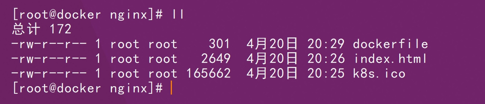
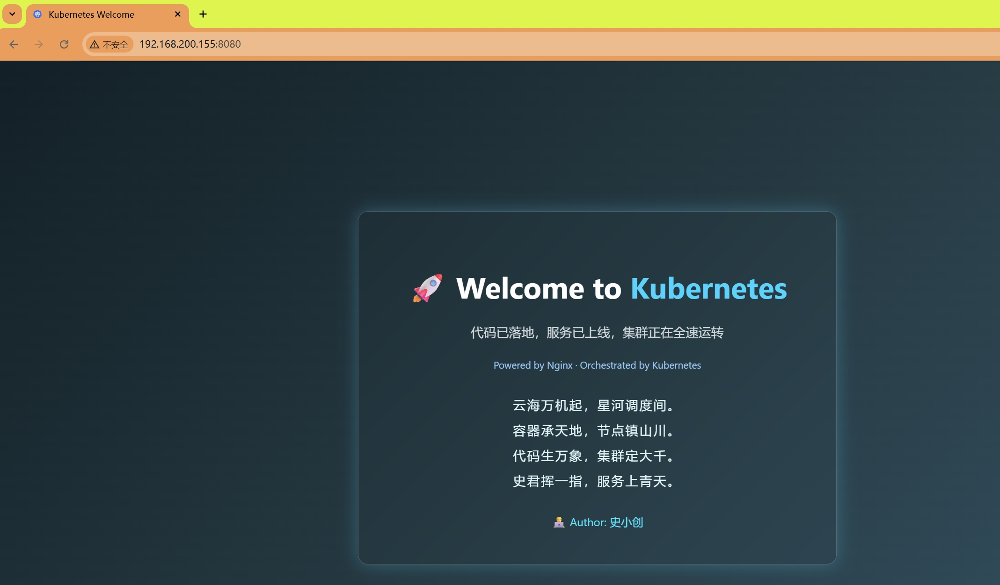
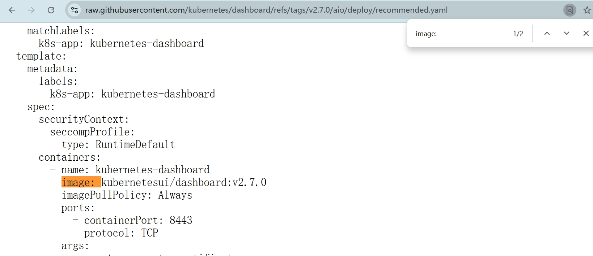
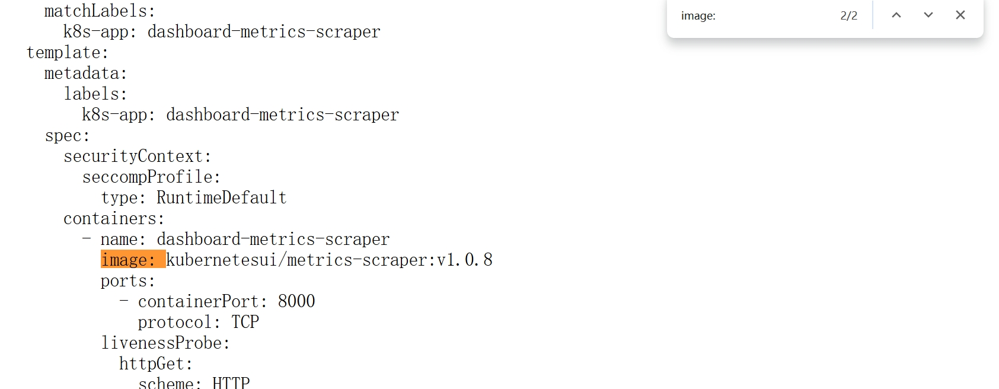
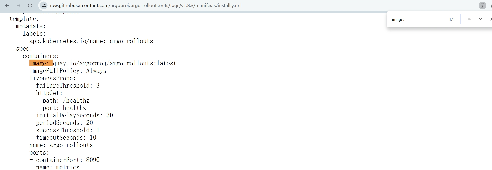
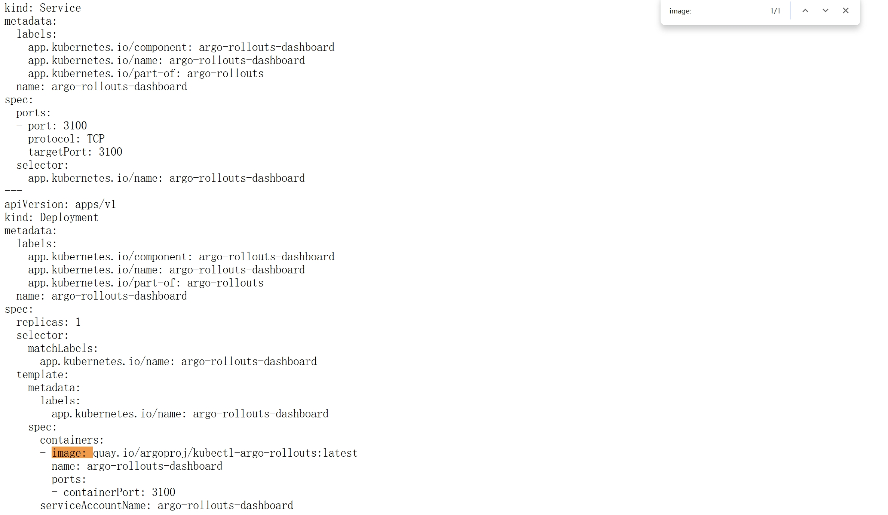
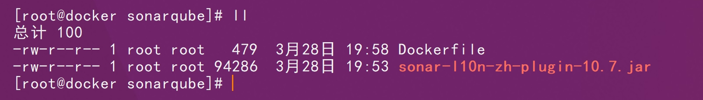

```http
https://hub.docker.com/u/shixiaochuangk8s
```

# 01、stress

```sh
docker pull polinux/stress:1.0.4
```

```sh
docker tag polinux/stress:1.0.4 shixiaochuangk8s/stress:1.0.4
```

```sh
docker push shixiaochuangk8s/stress:1.0.4
```

# 02、nginx

## 2.1、1.15-alpine

```sh
docker pull nginx:1.15-alpine
```

```sh
docker tag nginx:1.15-alpine shixiaochuangk8s/nginx:1.15-alpine
```

```sh
docker push shixiaochuangk8s/nginx:1.15-alpine
```

## 2.2、1.17.1

```sh
docker pull nginx:1.17.1
```

```sh
docker tag nginx:1.17.1 shixiaochuangk8s/nginx:1.17.1
```

```sh
docker push shixiaochuangk8s/nginx:1.17.1
```

## 2.3、1.17.2

```sh
docker pull nginx:1.17.2
```

```sh
docker tag nginx:1.17.2 shixiaochuangk8s/nginx:1.17.2
```

```sh
docker push shixiaochuangk8s/nginx:1.17.2
```

## 2.4、1.14-alpine

```sh
docker pull nginx:1.14-alpine
```

```sh
docker tag nginx:1.14-alpine shixiaochuangk8s/nginx:1.14-alpine
```

```sh
docker push shixiaochuangk8s/nginx:1.14-alpine
```

## 2.5、1.25

```sh
docker pull nginx:1.25
```

```sh
docker tag nginx:1.25 shixiaochuangk8s/nginx:1.25
```

```sh
docker push shixiaochuangk8s/nginx:1.25
```

## 2.6、1.17.3

```sh
docker pull nginx:1.17.3
```

```sh
docker tag nginx:1.17.3 shixiaochuangk8s/nginx:1.17.3
```

```sh
docker push shixiaochuangk8s/nginx:1.17.3
```

## 2.7、1.18

```sh
docker pull nginx:1.18
```

```sh
docker tag nginx:1.18 shixiaochuangk8s/nginx:1.18
```

```sh
docker push shixiaochuangk8s/nginx:1.18
```

## 2.8、1.28.0

```sh
docker pull nginx:1.28.0
```

```sh
docker tag nginx:1.28.0 shixiaochuangk8s/nginx:1.28.0
```

```sh
docker push shixiaochuangk8s/nginx:1.28.0
```

## 2.9、k8s-welcome

```html
<!DOCTYPE html>
<html lang="zh-CN">
<head>
    <meta charset="UTF-8">
    <title>Kubernetes Welcome</title>
    <style>
        body {
            margin: 0;
            font-family: "Segoe UI", "PingFang SC", "Microsoft YaHei", sans-serif;
            background: linear-gradient(135deg, #0f2027, #203a43, #2c5364);
            color: #ffffff;
            display: flex;
            justify-content: center;
            align-items: center;
            height: 100vh;
        }

        .container {
            text-align: center;
            animation: fadeIn 1.5s ease-in-out;
        }

        .box {
            border: 1px solid rgba(255,255,255,0.2);
            padding: 50px 70px;
            border-radius: 14px;
            backdrop-filter: blur(12px);
            box-shadow: 0 0 25px rgba(0, 212, 255, 0.3);
        }

        h1 {
            font-size: 42px;
            margin-bottom: 25px;
        }

        h1 span {
            color: #00d4ff;
        }

        .subtitle {
            font-size: 18px;
            color: #cfd8dc;
            margin-bottom: 25px;
        }

        .poem {
            margin-top: 30px;
            line-height: 2;
            font-size: 18px;
            color: #e0f7fa;
            letter-spacing: 2px;
        }

        .author {
            margin-top: 30px;
            font-size: 16px;
            color: #00e5ff;
        }

        .k8s {
            margin-top: 10px;
            font-size: 14px;
            color: #90caf9;
        }

        @keyframes fadeIn {
            from {
                opacity: 0;
                transform: translateY(20px);
            }
            to {
                opacity: 1;
                transform: translateY(0);
            }
        }
    </style>
</head>
<body>
    <div class="container">
        <div class="box">
            <h1>🚀 Welcome to <span>Kubernetes</span></h1>
            <div class="subtitle">
                代码已落地，服务已上线，集群正在全速运转
            </div>
            <div class="k8s">
                Powered by Nginx · Orchestrated by Kubernetes
            </div>

            <div class="poem">
                云海万机起，星河调度间。<br>
                容器承天地，节点镇山川。<br>
                代码生万象，集群定大千。<br>
                史君挥一指，服务上青天。
            </div>

            <div class="author">
                👨‍💻 Author: 史小创
            </div>
        </div>
    </div>
</body>
</html>
```

```dockerfile
# 使用官方 nginx 镜像
FROM nginx:1.28.0


# 拷贝页面和图标
COPY index.html /usr/share/nginx/html/index.html
COPY k8s.ico /usr/share/nginx/html/favicon.ico

# 暴露端口
EXPOSE 80

# 启动 nginx（官方镜像默认已定义，这行其实可以省略）
CMD ["nginx", "-g", "daemon off;"]
```



```sh
docker build -t nginx:k8s-welcome .
```

```sh
docker run -d -p 8080:80 nginx:k8s-welcome
```



```sh
docker tag nginx:k8s-welcome shixiaochuangk8s/nginx:k8s-welcome
```

```sh
docker push shixiaochuangk8s/nginx:k8s-welcome
```

# 03、busybox

## 3.1、1.30

```sh
docker pull busybox:1.30
```

```sh
docker tag busybox:1.30 shixiaochuangk8s/busybox:1.30
```

```sh
docker push shixiaochuangk8s/busybox:1.30
```

## 3.2、1.28

```sh
docker  pull busybox:1.28.3
```

```sh
docker tag busybox:1.28.3 shixiaochuangk8s/busybox:1.28.3
```

```sh
docker push shixiaochuangk8s/busybox:1.28.3
```

# 04、alpine

```sh
docker pull alpine:3.22.2
```

```sh
docker tag alpine:3.22.2 shixiaochuangk8s/alpine:3.22.2
```

```sh
docker push shixiaochuangk8s/alpine:3.22.2
```

```sh
docker pull alpine:3.12
```

```sh
docker tag alpine:3.12 shixiaochuangk8s/alpine:3.12
```

```sh
docker push shixiaochuangk8s/alpine:3.12
```

# 05、httpd

```sh
docker pull httpd:2.2
```

```sh
docker tag httpd:2.2 shixiaochuangk8s/httpd:2.2
```

```sh
docker push shixiaochuangk8s/httpd:2.2
```

```sh
docker pull httpd:2.4
```

```sh
docker tag httpd:2.4 shixiaochuangk8s/httpd:2.4
```

```sh
docker push shixiaochuangk8s/httpd:2.4
```

# 06、Redis

```
docker pull redis:6.2
```

```shell
docker tag redis:6.2 shixiaochuangk8s/redis:6.2
```

```sh
docker push shixiaochuangk8s/redis:6.2
```

```sh
docker pull redis:7.4.2
```

```sh
docker tag redis:7.4.2 shixiaochuangk8s/redis:7.4.2
```

```sh
docker push shixiaochuangk8s/redis:7.4.2
```

# 07、metrics-server

```sh
docker pull registry.k8s.io/metrics-server/metrics-server:v0.8.0
```

```sh
docker tag registry.k8s.io/metrics-server/metrics-server:v0.8.0 shixiaochuangk8s/metrics-server:v0.8.0
```

```sh
docker push shixiaochuangk8s/metrics-server:v0.8.0
```

# 08、perl

```sh
docker pull perl:5.43.4
```

```sh
docker tag perl:5.43.4 shixiaochuangk8s/perl:5.43.4
```

```sh
docker push shixiaochuangk8s/perl:5.43.4
```

# 09、MySQL

```sh
docker pull mysql:5.6
```

```sh
docker tag mysql:5.6 shixiaochuangk8s/mysql:5.6
```

```sh
docker push shixiaochuangk8s/mysql:5.6
```

```sg
docker pull mysql:5.7
```

```sh
docker tag mysql:5.7 shixiaochuangk8s/mysql:5.7
```

```sh
docker push shixiaochuangk8s/mysql:5.7
```

```
docker pull mysql:8.0.33
```

```sh
docker tag mysql:8.0.33 shixiaochuangk8s/mysql:8.0.33
```

```sh
docker push shixiaochuangk8s/mysql:8.0.33
```

# 10、netshoot

这个镜像里有 **dig / curl / ping / tcpdump / nslookup**。

```sh
docker pull nicolaka/netshoot:v0.14
```

```sh
docker tag nicolaka/netshoot:v0.14 shixiaochuangk8s/netshoot:v0.14
```

```sh
docker push shixiaochuangk8s/netshoot:v0.14
```

# 15、dashboard

```http
https://raw.githubusercontent.com/kubernetes/dashboard/refs/tags/v2.7.0/aio/deploy/recommended.yaml
```





```sh
docker pull kubernetesui/dashboard:v2.7.0
```

```sh
docker pull kubernetesui/metrics-scraper:v1.0.8
```

```sh
docker tag kubernetesui/dashboard:v2.7.0 shixiaochuangk8s/kubernetesui-dashboard:v2.7.0
```

```sh
docker tag kubernetesui/metrics-scraper:v1.0.8 shixiaochuangk8s/kubernetesui-metrics-scraper:v1.0.8
```

```sh
docker push shixiaochuangk8s/kubernetesui-dashboard:v2.7.0
```

```sh
docker push shixiaochuangk8s/kubernetesui-metrics-scraper:v1.0.8
```

# 16、postgres

```sh
docker pull postgres:18
```

```sh
docker tag postgres:18 shixiaochuangk8s/postgres:18
```

```sh
docker push shixiaochuangk8s/postgres:18
```

```sh
docker pull postgres:15.14
```

```sh
docker tag postgres:15.14 shixiaochuangk8s/postgres:15.14
```

```sh
docker push shixiaochuangk8s/postgres:15.14
```

# 17、gitlab

```sh
docker pull gitlab/gitlab-ce:18.4.1-ce.0
```

```sh
docker tag gitlab/gitlab-ce:18.4.1-ce.0 shixiaochuangk8s/gitlab:18.4.1-ce.0
```

```sh
docker push shixiaochuangk8s/gitlab:18.4.1-ce.0
```

```sh
docker pull gitlab/gitlab-ce:18.8.4-ce.0
```

```sh
docker tag gitlab/gitlab-ce:18.8.4-ce.0 shixiaochuangk8s/gitlab-ce:18.8.4-ce.0
```

```sh
docker push shixiaochuangk8s/gitlab-ce:18.8.4-ce.0
```

# 18、Jenkins

```sh
docker pull jenkins/jenkins:2.479.1-lts-jdk17
```

```sh
docker tag jenkins/jenkins:2.479.1-lts-jdk17 shixiaochuangk8s/jenkins:2.479.1-lts-jdk17
```

```sh
docker push shixiaochuangk8s/jenkins:2.479.1-lts-jdk17
```

```sh
docker pull jenkins/jenkins:2.541.1-lts
```

```sh
docker tag jenkins/jenkins:2.541.1-lts shixiaochuangk8s/jenkins:2.541.1-lts
```

```sh
docker push shixiaochuangk8s/jenkins:2.541.1-lts
```

# 19、NACOS

```sh
docker pull nacos/nacos-server:v2.0.3
```

```sh
docker tag nacos/nacos-server:v2.0.3 shixiaochuangk8s/nacos:v2.0.3
```

```sh
docker push shixiaochuangk8s/nacos:v2.0.3
```

```sh
docker pull nacos/nacos-server:v2.2.0
```

```sh
docker tag nacos/nacos-server:v2.2.0 shixiaochuangk8s/nacos:v2.2.0 
```

```sh
docker push shixiaochuangk8s/nacos:v2.2.0
```

```sh
docker pull nacos/nacos-server:v2.4.0
```

```sh
docker tag nacos/nacos-server:v2.4.0  shixiaochuangk8s/nacos:v2.4.0
```

```sh
docker push shixiaochuangk8s/nacos:v2.4.0
```

```sh
docker pull nacos/nacos-peer-finder-plugin:1.1
```

```sh
docker tag nacos/nacos-peer-finder-plugin:1.1  shixiaochuangk8s/nacos-peer-finder-plugin:1.1
```

```sh
docker push shixiaochuangk8s/nacos-peer-finder-plugin:1.1
```

```sh
docker pull nacos/nacos-server:v2.5.2
```

```sh
docker tag nacos/nacos-server:v2.5.2 shixiaochuangk8s/nacos:v2.5.2
```

```sh
docker push shixiaochuangk8s/nacos:v2.5.2
```

# 20、argo-rollouts

```http
https://raw.githubusercontent.com/argoproj/argo-rollouts/refs/tags/v1.8.3/manifests/install.yaml
```



```sh
docker pull quay.io/argoproj/argo-rollouts:v1.8.3
```

```sh
docker tag  quay.io/argoproj/argo-rollouts:v1.8.3 shixiaochuangk8s/argoproj-argo-rollouts:v1.8.3
```

```sh
docker push shixiaochuangk8s/argoproj-argo-rollouts:v1.8.3
```

# 21、argo-rollouts-dashboard

```http
https://raw.githubusercontent.com/argoproj/argo-rollouts/refs/tags/v1.8.3/manifests/dashboard-install.yaml
```



```sh
docker pull quay.io/argoproj/kubectl-argo-rollouts:v1.8.3
```

```sh
docker tag quay.io/argoproj/kubectl-argo-rollouts:v1.8.3 shixiaochuangk8s/argoproj-kubectl-argo-rollouts:v1.8.3 
```

```sh
docker push shixiaochuangk8s/argoproj-kubectl-argo-rollouts:v1.8.3 
```

# 22、MInio

```sh
docker pull minio/minio:RELEASE.2024-03-10T02-53-48Z
```

```sh
docker tag minio/minio:RELEASE.2024-03-10T02-53-48Z shixiaochuangk8s/minio:RELEASE.2024-03-10T02-53-48Z
```

```sh
docker push shixiaochuangk8s/minio:RELEASE.2024-03-10T02-53-48Z
```

# 23、Prometheus

```sh
docker pull prom/prometheus:v3.5.0
```

```sh
docker tag prom/prometheus:v3.5.0 shixiaochuangk8s/prometheus:v3.5.0
```

```sh
docker push shixiaochuangk8s/prometheus:v3.5.0
```

# 24、redis_exporter

```sh
docker pull oliver006/redis_exporter:v1.80.1
```

```sh
docker tag oliver006/redis_exporter:v1.80.1 shixiaochuangk8s/redis_exporter:v1.80.1 
```

```sh
docker push shixiaochuangk8s/redis_exporter:v1.80.1 
```

# 25、node-exporter

```sh
docker pull prom/node-exporter:v1.10.1
```

```sh
docker tag prom/node-exporter:v1.10.1 shixiaochuangk8s/node-exporter:v1.10.1
```

```sh
docker push shixiaochuangk8s/node-exporter:v1.10.1
```

# 26、traefik

```sh
docker  pull traefik:v3.6
```

```sh
docker tag traefik:v3.6 shixiaochuangk8s/traefik:v3.6
```

```sh
docker push shixiaochuangk8s/traefik:v3.6
```

# 27、mongo

## 8.0.16

```sh
docker pull mongo:8.0.16
```

```sh
docker tag mongo:8.0.16 shixiaochuangk8s/mongo:8.0.16
```

```sh
docker push shixiaochuangk8s/mongo:8.0.16
```

## 6.0.6

```sh
docker pull mongo:6.0.6
```

```sh
docker tag  mongo:6.0.6 shixiaochuangk8s/mongo:6.0.6
```

```sh
docker push shixiaochuangk8s/mongo:6.0.6
```

# 28、RabbitMQ

```sh
docker pull rabbitmq:3.13.0-management
```

```sh
docker tag rabbitmq:3.13.0-management shixiaochuangk8s/rabbitmq:3.13.0-management 
```

```sh
docker push shixiaochuangk8s/rabbitmq:3.13.0-management 
```

# 29、nexus3

```sh
docker pull sonatype/nexus3:3.86.2
```

```sh
docker tag sonatype/nexus3:3.86.2 shixiaochuangk8s/nexus3:3.86.2
```

```sh
docker push shixiaochuangk8s/nexus3:3.86.2
```

# 30、elasticsearch

```sh
docker pull elasticsearch:7.17.28
```

```sh
docker tag elasticsearch:7.17.28 shixiaochuangk8s/elasticsearch:7.17.28 
```

```sh
docker push shixiaochuangk8s/elasticsearch:7.17.28 
```

# 31、Kibaba

```sh
docker pull kibana:7.17.28
```

```sh
docker tag kibana:7.17.28  shixiaochuangk8s/kibana:7.17.28
```

```sh
docker push shixiaochuangk8s/kibana:7.17.28
```

# 32、wordpress

## 4.6.1-apache

```sh
docker pull wordpress:4.6.1-apache
```

```sh
docker tag  wordpress:4.6.1-apache shixiaochuangk8s/wordpress:4.6.1-apache
```

```sh
docker push shixiaochuangk8s/wordpress:4.6.1-apache
```

## 5.3.2-apache

```sh
docker pull wordpress:5.3.2-apache
```

```sh
docker tag wordpress:5.3.2-apache shixiaochuangk8s/wordpress:5.3.2-apache
```

```sh
docker push shixiaochuangk8s/wordpress:5.3.2-apache
```

# 33、grafana

```sh
docker pull grafana/grafana:12.0.1
```

```sh
docker tag grafana/grafana:12.0.1 shixiaochuangk8s/grafana:12.0.1 
```

```sh
docker push shixiaochuangk8s/grafana:12.0.1
```

# 34、whoamiudp

```sh
docker pull traefik/whoamiudp:v0.2.3
```

```sh
docker tag traefik/whoamiudp:v0.2.3 shixiaochuangk8s/traefik-whoamiudp:v0.2.3 
```

```sh
docker push shixiaochuangk8s/traefik-whoamiudp:v0.2.3 
```

# 35、filebeat

```sh
docker pull docker.io/elastic/filebeat:7.17.28
```

```sh
docker tag docker.io/elastic/filebeat:7.17.28 shixiaochuangk8s/elastic-filebeat:7.17.28
```

```sh
docker push shixiaochuangk8s/elastic-filebeat:7.17.28
```

# 36、tomcat

```sh
docker pull tomcat:9.0.48
```

```sh
docker tag tomcat:9.0.48  shixiaochuangk8s/tomcat:9.0.48
```

```sh
docker push shixiaochuangk8s/tomcat:9.0.48
```

# 37、 curl

```sh
docker pull curlimages/curl:8.18.0
```

```sh
docker tag curlimages/curl:8.18.0 shixiaochuangk8s/curlimages-curl:8.18.0
```

```sh
docker push shixiaochuangk8s/curlimages-curl:8.18.0
```

# 38、alertmanager

```shell
docker pull prom/alertmanager:v0.31.0
```

```sh
docker tag prom/alertmanager:v0.31.0 shixiaochuangk8s/alertmanager:v0.31.0
```

```sh
docker push shixiaochuangk8s/alertmanager:v0.31.0
```

# 39、thanos

```sh
docker pull thanosio/thanos:v0.40.0
```

```sh
docker tag thanosio/thanos:v0.40.0 shixiaochuangk8s/thanosio-thanos:v0.40.0
```

```sh
docker push shixiaochuangk8s/thanosio-thanos:v0.40.0
```

# 39、nginx-prometheus-exporter

```sh
docker pull nginx/nginx-prometheus-exporter:1.5.1
```

```sh
docker tag nginx/nginx-prometheus-exporter:1.5.1 shixiaochuangk8s/nginx-prometheus-exporter:1.5.1
```

```sh
docker push shixiaochuangk8s/nginx-prometheus-exporter:1.5.1
```

# 40、SonarQube

## 10.7.0-community

```sh
docker pull sonarqube:10.7.0-community
```

```sh
docker tag sonarqube:10.7.0-community shixiaochuangk8s/sonarqube:10.7.0-community
```

```sh
docker push shixiaochuangk8s/sonarqube:10.7.0-community
```

## 10.7.0-community-cn

```sh
curl -I https://github.com/xuhuisheng/sonar-l10n-zh/releases/download/sonar-l10n-zh-plugin-10.7/sonar-l10n-zh-plugin-10.7.jar
```

```dockerfile
FROM sonarqube:10.7.0-community

# 切换到 root 权限（官方镜像默认是 sonarqube 用户）
USER root

# 创建插件目录（其实官方已存在，但确保一下）
RUN mkdir -p /opt/sonarqube/extensions/plugins

# 拷贝中文插件
COPY sonar-l10n-zh-plugin-10.7.jar /opt/sonarqube/extensions/plugins/

# 修改权限（很关键，否则可能加载失败）
RUN chown -R 1000:1000 /opt/sonarqube/extensions/plugins

# 切回默认用户
USER sonarqube
```



```sh
docker build -t sonarqube:10.7.0-community-zh .
```

```sh
docker tag sonarqube:10.7.0-community-zh shixiaochuangk8s/sonarqube:10.7.0-community-zh
```

```sh
docker push shixiaochuangk8s/sonarqube:10.7.0-community-zh
```

# 41、Consul

## 1.15.4

```sh
docker pull consul:1.15.4
```

```sh
docker tag consul:1.15.4 shixiaochuangk8s/consul:1.15.4
```

```sh
docker push shixiaochuangk8s/consul:1.15.4
```

## 1.9.6

```sh
docker pull consul:1.9.6
```

```sh
docker tag  consul:1.9.6 shixiaochuangk8s/consul:1.9.6
```

```sh
docker push shixiaochuangk8s/consul:1.9.6
```

# 42、seata-server

```sh
docker pull seataio/seata-server:1.5.1
```

```sh
docker tag seataio/seata-server:1.5.1 shixiaochuangk8s/seata-server:1.5.1
```

```sh
docker push shixiaochuangk8s/seata-server:1.5.1
```


